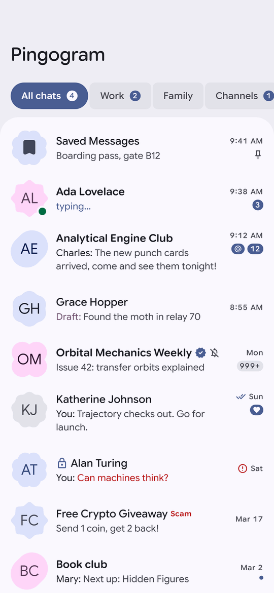
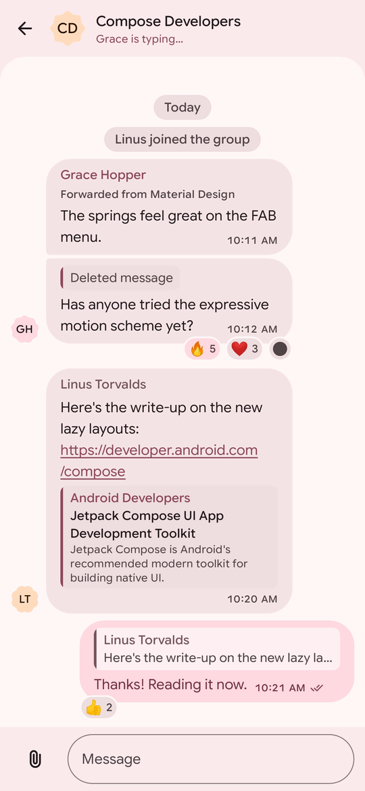
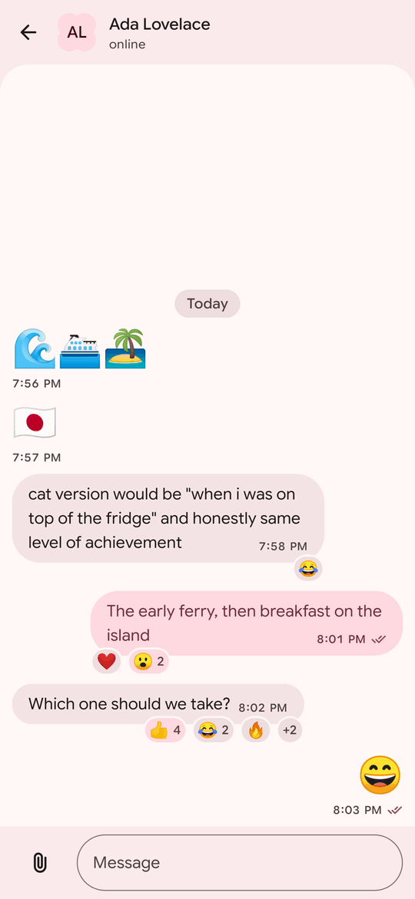
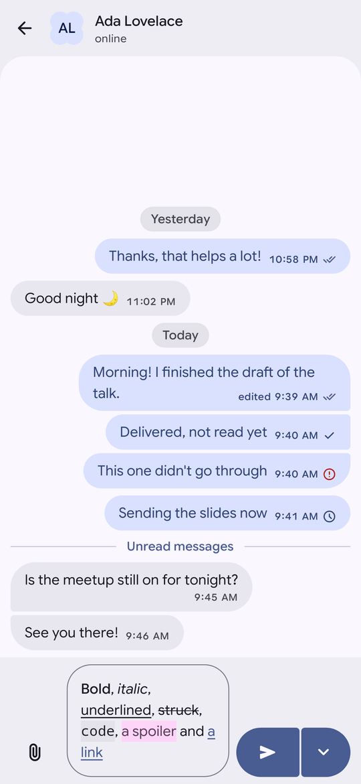
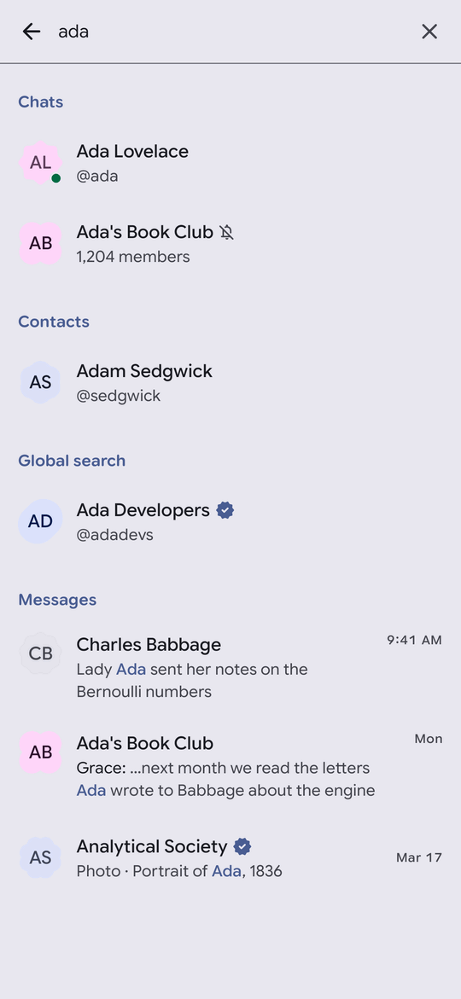
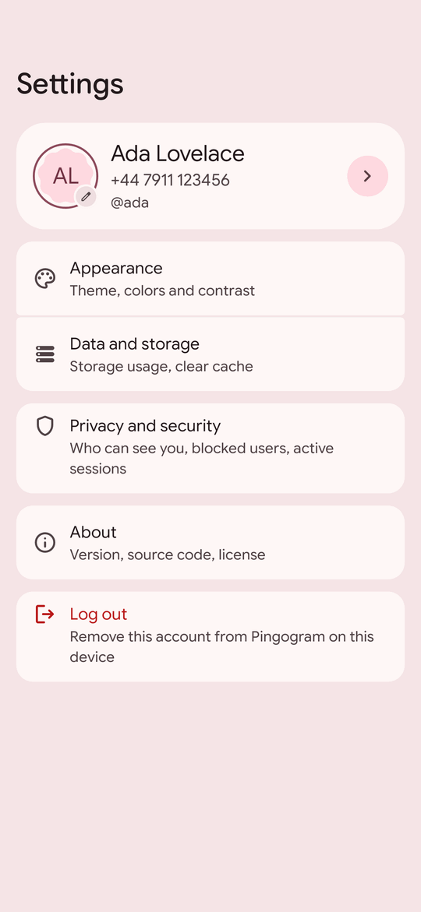
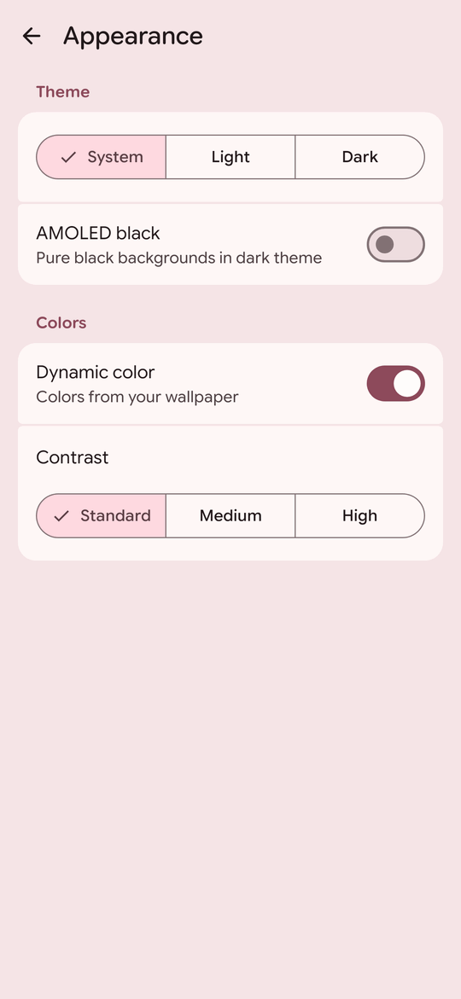
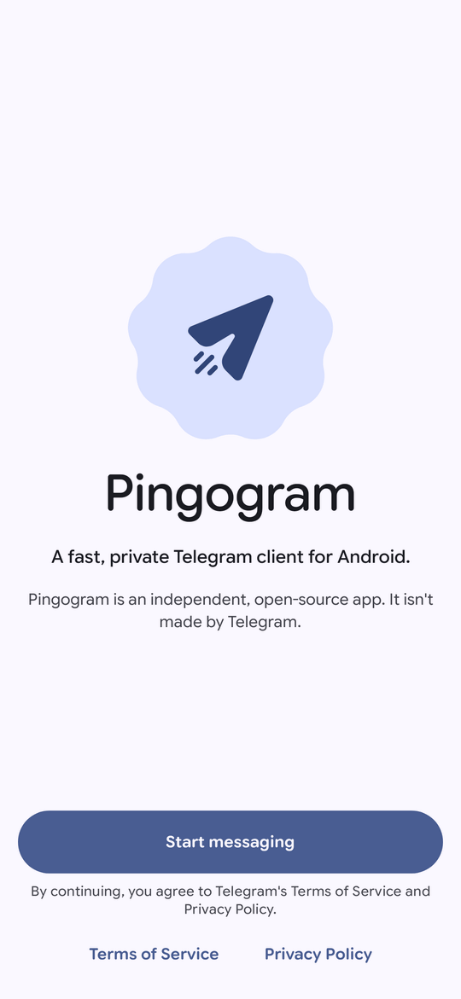
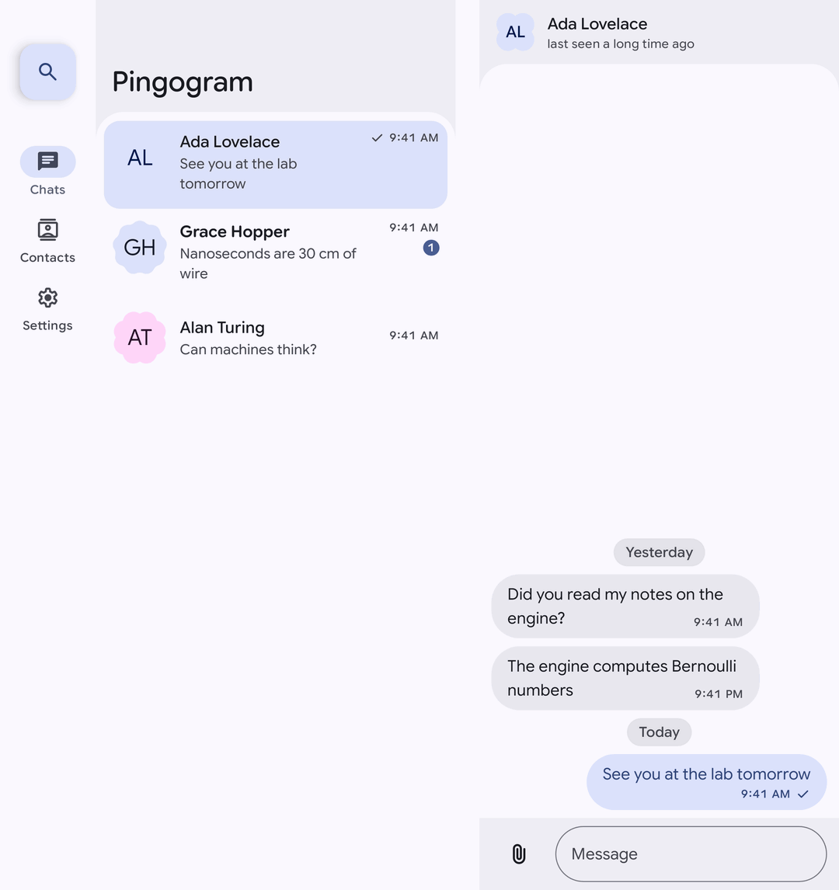

<h1 align="center">
  <picture>
    <source media="(prefers-color-scheme: dark)" srcset="docs/images/logo_full_dark.svg">
    
  </picture>
</h1>

<p align="center">
  <strong>A Telegram client for Android that looks and feels like a Google app.</strong>
</p>

<p align="center">
  <a href="https://github.com/kyra-labs/pingogram-android/actions/workflows/ci.yml"></a>
  <a href="https://github.com/kyra-labs/pingogram-android/releases"></a>
  <a href="LICENSE"></a>
  <a href="https://hosted.weblate.org/engage/pingogram/"></a>
</p>

Pingogram is an open-source, third-party Telegram client for Android, written from scratch in
Kotlin and Jetpack Compose on top of [TDLib](https://github.com/tdlib/td), Telegram's official
client library. You sign in with your existing Telegram account and keep all your chats; what
changes is the interface, which follows Google's Material 3 Expressive design: Google Sans Flex
type, expressive shapes and spring motion, dynamic color from your wallpaper, and layouts that
adapt from phones to tablets and foldables. There are no analytics, no ads and no telemetry: the
app talks only to Telegram's servers, through TDLib, and to links you open.

Pingogram is **not** affiliated with Telegram. It is a third-party client that uses Telegram's
official client library, [TDLib](https://github.com/tdlib/td), and complies with the
[Telegram API Terms of Service](https://core.telegram.org/api/terms).

> [!NOTE]
> Pingogram is an **early beta** (0.4.0). Everyday messaging works, with notifications,
> voice messages and stickers, contacts, profiles, groups and channels, forum topics and secret
> chats; calls are not there yet. See [what works today](#what-works-today) and [what is missing](#not-yet).

## Screenshots

<!-- Generated from the Roborazzi goldens; regenerate with tools/readme/screenshots.sh -->

<table>
  <tr>
    <td align="center" width="25%">
      <picture>
        <source media="(prefers-color-scheme: dark)" srcset="docs/screenshots/chats-dark.png">
        
      </picture>
      <br><sub>Chat list with folders</sub>
    </td>
    <td align="center" width="25%">
      <picture>
        <source media="(prefers-color-scheme: dark)" srcset="docs/screenshots/chat-dark.png">
        
      </picture>
      <br><sub>Replies, link previews, reactions</sub>
    </td>
    <td align="center" width="25%">
      <picture>
        <source media="(prefers-color-scheme: dark)" srcset="docs/screenshots/reactions-dark.png">
        
      </picture>
      <br><sub>Expressive bubbles and emoji</sub>
    </td>
    <td align="center" width="25%">
      <picture>
        <source media="(prefers-color-scheme: dark)" srcset="docs/screenshots/composer-dark.png">
        
      </picture>
      <br><sub>Formatting in the composer</sub>
    </td>
  </tr>
  <tr>
    <td align="center" width="25%">
      <picture>
        <source media="(prefers-color-scheme: dark)" srcset="docs/screenshots/search-dark.png">
        
      </picture>
      <br><sub>Search chats and messages</sub>
    </td>
    <td align="center" width="25%">
      <picture>
        <source media="(prefers-color-scheme: dark)" srcset="docs/screenshots/settings-dark.png">
        
      </picture>
      <br><sub>Settings</sub>
    </td>
    <td align="center" width="25%">
      <picture>
        <source media="(prefers-color-scheme: dark)" srcset="docs/screenshots/appearance-dark.png">
        
      </picture>
      <br><sub>Theme, dynamic color, contrast</sub>
    </td>
    <td align="center" width="25%">
      <picture>
        <source media="(prefers-color-scheme: dark)" srcset="docs/screenshots/welcome-dark.png">
        
      </picture>
      <br><sub>Welcome</sub>
    </td>
  </tr>
  <tr>
    <td align="center" colspan="4">
      <picture>
        <source media="(prefers-color-scheme: dark)" srcset="docs/screenshots/tablet-dark.png">
        
      </picture>
      <br><sub>Chat list and conversation side by side on tablets and foldables</sub>
    </td>
  </tr>
</table>

<sub>Screenshots come from the app's screenshot tests, with sample data, in the brand colors
(on Android 12+ the app takes its colors from your wallpaper by default). They follow your GitHub
light or dark theme.</sub>

## What works today

- **Sign-in:** phone number with country picker, every login code type, two-step verification
  with password recovery, new-account registration, QR code login and email verification.
- **Chat list:** folders as tabs, unread, mention and reaction badges, typing and online status,
  drafts, swipe to archive or mark as read, multi-select with a floating toolbar (pin, mute,
  archive, mark as read, delete) and the archive.
- **Conversations:** paged history that opens at the first unread message, Material 3 Expressive
  bubbles, formatted text, replies, forwarded headers, link previews and reactions; photos and
  albums, videos, GIFs, stickers (animated too), voice messages and music, documents, polls,
  locations and contacts; sponsored messages in channels as Telegram requires; a full-screen
  media viewer with zoom, share and save.
- **Writing:** text with formatting, silent and scheduled send, drafts synced with your other
  devices; reply, edit, delete, pin, react (with every reaction the chat allows), forward,
  select, report and save; attach photos and videos (as albums), files, your location, contacts,
  polls and quizzes; record voice messages; an emoji and sticker panel; send as a channel or
  anonymously where Telegram allows it. Files you send or download keep going in the background.
- **Notifications:** per chat, with replies and mark as read from the notification, settings and
  exceptions per kind of chat, and an optional "Keep connected" mode for the GitHub builds.
- **Contacts:** your Telegram contacts in alphabetical sections with a letter index, search, adding
  by phone number or username, editing, deleting and invitations to Telegram. Optional contacts
  sync (off by default) finds who of your phone's contacts uses Telegram: only while it is on are
  their names and numbers read and sent to Telegram, when you turn it on, open Contacts or tap
  Sync now, never in the background; turning it off deletes them from Telegram.
- **Profiles, groups and channels:** user profiles with their shared media; group and channel info
  with members, admins and their rights, permissions and slow mode, invite links, photo, name and
  description, leaving and deleting, as far as your rights allow; creating groups and channels.
- **Bots:** command menus and suggestions, the buttons bots put under their messages, bot keyboards, inline bots
  ("@gif cats") and a Start button for bots you have not used yet. Mini Apps, games and payments are not there yet.
- **Voice calls:** end-to-end encrypted, with the four emojis to compare; they ring like phone calls, on the lock
  screen too, and work with your headset, car and watch.
- **Inside chats:** secret chats (end-to-end encrypted, on this phone only, with a self-destruct
  timer and the encryption key to compare), forum topics, comment threads under channel posts and
  a pinned messages bar.
- **Sharing into Pingogram:** text, links, photos, videos and files shared from other apps go to the
  chats you pick, or straight to one from Android's share sheet.
- **Search** across your chats, contacts, public chats and channels, and messages.
- **Telegram links:** `tg://`, `t.me`, `telegram.me` and `telegram.dog` links from other apps
  and in messages open in Pingogram (usernames, phone numbers, message links, invite links,
  Saved Messages, settings pages and more); on Android 12 and later, turn on "Open supported
  links" for Pingogram (Settings → About → Open Telegram links) so `t.me` links skip the browser.
- **QR codes:** scan Telegram QR codes with the camera or from an image, link a desktop device
  by its login code (Pingogram always asks first), and show your own profile's QR code. Join
  groups and channels from invite links, and see a channel's boosts.
- **Settings:** your account and profile (photo, name, username, bio), privacy, blocked users,
  active sessions, two-step verification (set, change, recover), passcode lock with fingerprint
  or face, notifications, appearance (system, light or dark theme, AMOLED black, contrast, your wallpaper's colors
  or one of 13 color themes; message text size, bubble corners and a chat wallpaper), data and storage (usage, clear
  cache, automatic download per network), language and about with the open-source licenses. "Send feedback or
  report a bug" prepares a report on your phone that you read and share yourself.
- **On the home screen:** a widget of your recent chats, and shortcuts on the app's icon for New chat, Search and
  Saved Messages.
- **Built the Android way:** a floating navigation bar on phones and a navigation rail with a
  list-detail layout on larger screens, edge-to-edge, predictive back, and layouts that hold up
  at 200% font size and with TalkBack.

### Permissions

Pingogram asks for each permission only when you use what needs it, and says why first:
notifications (Android 13+), the microphone for voice messages and calls, the location you send, your
contacts only if you turn on contacts sync, and the camera only for the QR code scanner. The
scanner reads codes on your phone: nothing the camera sees is kept or sent, only the Telegram
link a code holds is opened through TDLib. There are no analytics, ads or trackers.

### Not yet

- Recording video messages; creating and editing forum topics
- Video calls (a video call reaches you as a voice call) and group calls, planned next
  ([ADR 0019](docs/adr/0019-video-and-group-calls-scope.md))

The [roadmap](docs/ROADMAP.md) lists the milestones towards 1.0, which also aims for faster
start-up and smoother scrolling than the official app on the same device
([performance budgets](docs/PERFORMANCE.md)).

## Translations

Pingogram is translated on [Hosted Weblate](https://hosted.weblate.org/engage/pingogram/). A language ships once 80% of
the app is translated; [docs/TRANSLATING.md](docs/TRANSLATING.md) explains how to help and how strings are written.

## Download

Get the APK from the [Releases page](https://github.com/kyra-labs/pingogram-android/releases).
All releases before 1.0 are marked as pre-releases. Use `-universal.apk` unless you know your
device's ABI, and verify it with `SHA256SUMS.txt`. Pingogram needs Android 8.0 or newer and
installs alongside other Telegram apps. The plain APKs have no Google services, so new messages
arrive while Pingogram runs; turn on Settings → Notifications → "Keep connected" to get them when
it is closed. The APKs ending in `-gms` get notifications through Google's push service instead,
on phones with Google Play services; both are the same app, and one replaces the other with your
data kept.

<a href="https://apps.obtainium.imranr.dev/redirect?r=obtainium://add/https://github.com/kyra-labs/pingogram-android"></a>

[Obtainium](https://github.com/ImranR98/Obtainium) installs Pingogram from these releases and keeps it
updated. Until 1.0, turn on "Include prereleases" when adding it, and set the APK filter to
`arm64-v8a\.apk$` (most phones) or `arm64-v8a-gms\.apk$` for the build with Google's push service.

## Building

```bash
cp secrets.properties.example secrets.properties   # add your api_id / api_hash from my.telegram.org
./gradlew assembleFossDebug                        # APK in app/build/outputs/apk/foss/debug/
./gradlew check                                    # ktlint, detekt, lint, unit and screenshot tests
```

Requirements: JDK 17+, an Android SDK with platform 37 (compileSdk), Android Studio (latest
stable). `secrets.properties` is git-ignored; the build stops with a clear message if it is
missing or malformed. The TDLib AAR is downloaded automatically from this repository's `tdlib-*`
releases and checked against a pinned SHA-256 (see [docs/TDLIB.md](docs/TDLIB.md)).

## Documentation

| Doc | Contents |
|---|---|
| [REQUIREMENTS.md](REQUIREMENTS.md) | Scope, compliance, functional & non-functional requirements |
| [docs/ROADMAP.md](docs/ROADMAP.md) | Milestones |
| [CHANGELOG.md](CHANGELOG.md) | What changed in each release |
| [docs/ARCHITECTURE.md](docs/ARCHITECTURE.md) | Modules, layers, data flow |
| [docs/DESIGN_SYSTEM.md](docs/DESIGN_SYSTEM.md) | Material 3 Expressive rules |
| [docs/TDLIB.md](docs/TDLIB.md) | TDLib build and wrapper |
| [docs/PERFORMANCE.md](docs/PERFORMANCE.md) | Performance budgets and optimization rules |
| [docs/TESTING.md](docs/TESTING.md) | Test strategy |
| [docs/RELEASE.md](docs/RELEASE.md) | Versioning, signing, releases |
| [docs/OWNER_SETUP.md](docs/OWNER_SETUP.md) | Maintainer setup checklist |
| [CLAUDE.md](CLAUDE.md) | Rules for AI-assisted development |

## Contributing

See [CONTRIBUTING.md](CONTRIBUTING.md) and the [Code of Conduct](CODE_OF_CONDUCT.md). Commits
must be signed off (DCO). Report security issues as described in [SECURITY.md](SECURITY.md).

## License

GPL-3.0-or-later — see [LICENSE](LICENSE), with an additional permission to combine Pingogram with Google's Play
services and Firebase libraries, which the `gms` build uses for push notifications
([LICENSE-EXCEPTION.md](LICENSE-EXCEPTION.md)). TDLib is licensed under the Boost Software License 1.0.
Google Sans Flex is used under the SIL Open Font License 1.1.
"Telegram" is a trademark of Telegram FZ-LLC; Pingogram is an independent project.
