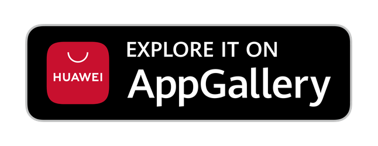
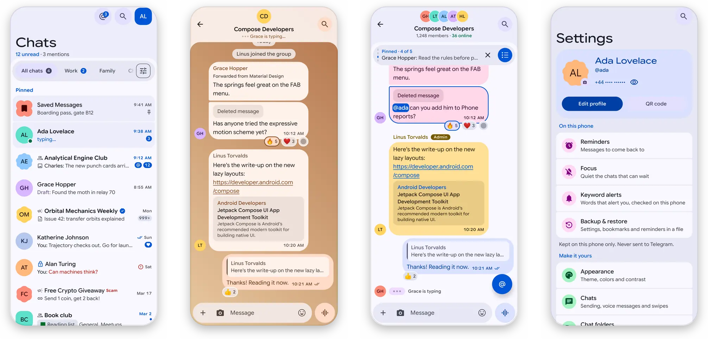
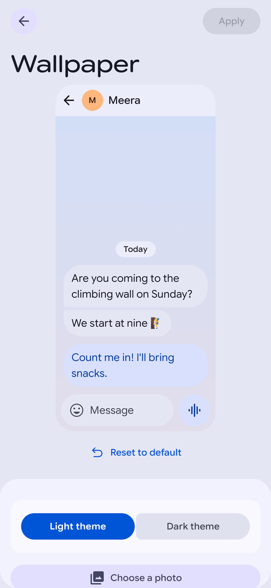
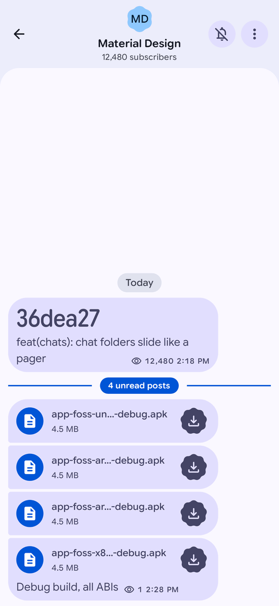
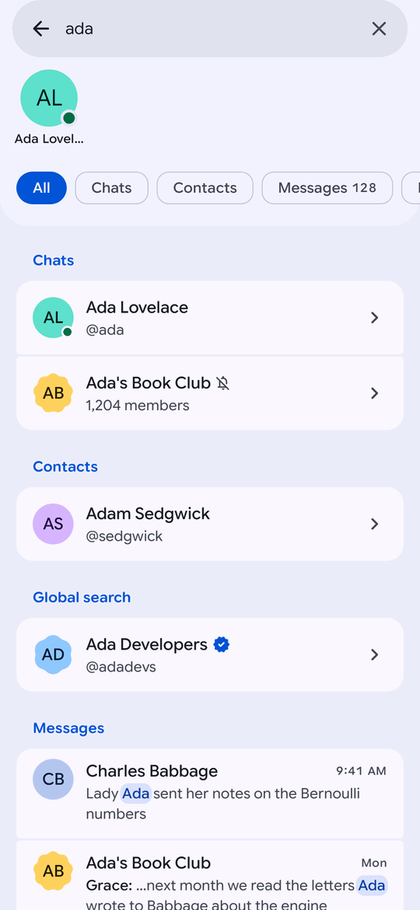
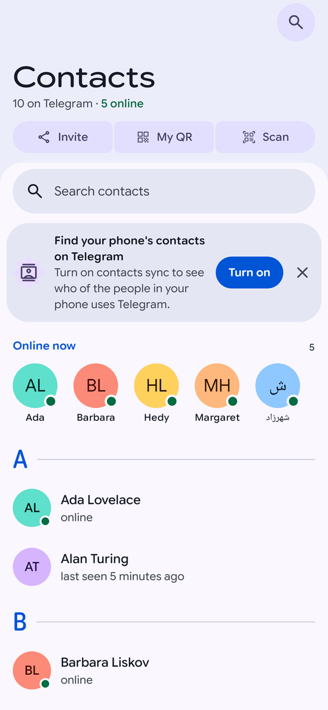
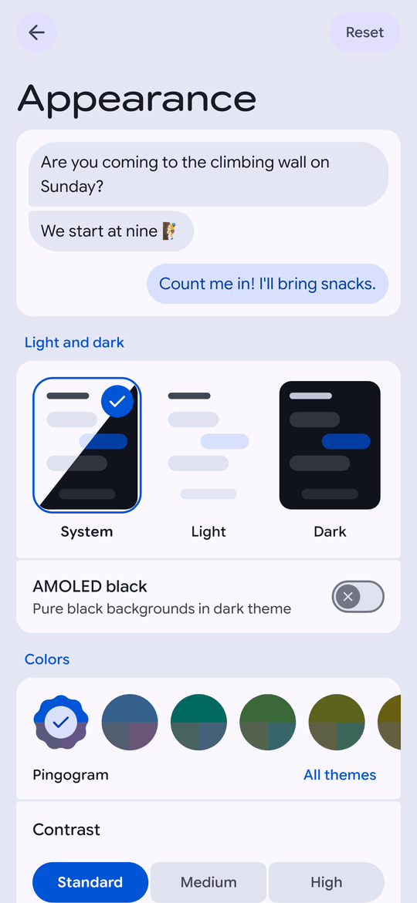
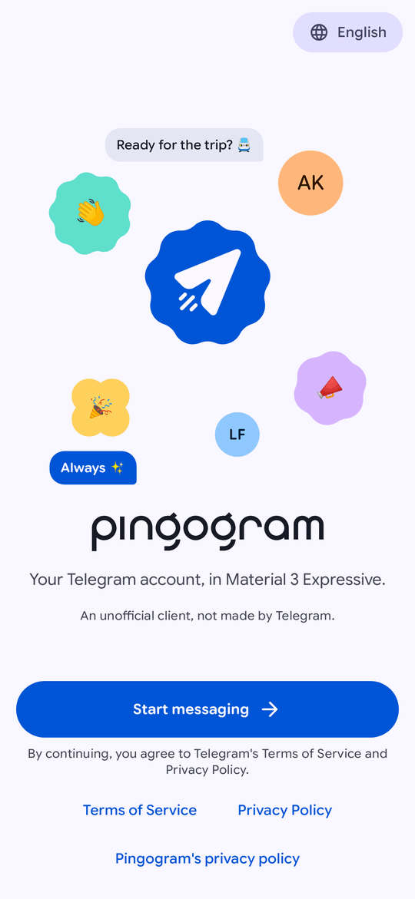
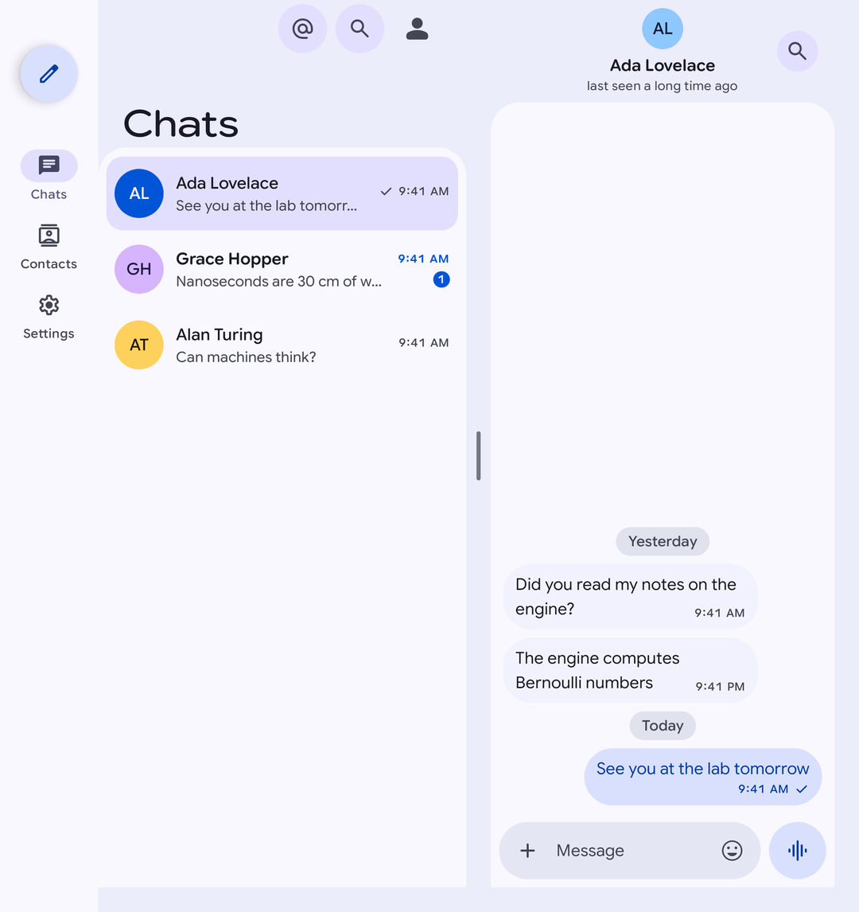

<div align="center">

<picture>
  <source media="(prefers-color-scheme: dark)" srcset="docs/images/logo_full_dark.svg">
  
</picture>

<h3>A fast, private Telegram client for Android, in Material 3 Expressive.</h3>

<p>
<a href="https://play.google.com/store/apps/details?id=dev.kyralabs.pingogram"></a>
<a href="https://github.com/kyra-labs/pingogram-android/releases/latest"></a>
<a href="https://url.cloud.huawei.com/CXKdcPQ1DW"></a>
<a href="https://apps.obtainium.imranr.dev/redirect?r=obtainium://add/https://github.com/kyra-labs/pingogram-android"></a>
</p>

<p>
  <a href="https://github.com/kyra-labs/pingogram-android/actions/workflows/ci.yml"></a>
  <a href="https://github.com/kyra-labs/pingogram-android/releases"></a>
  <a href="LICENSE"></a>
  <a href="https://hosted.weblate.org/engage/pingogram/"></a>
</p>

<!-- Generated from the Roborazzi goldens; regenerate with tools/readme/screenshots.sh -->
<picture>
  <source media="(prefers-color-scheme: dark)" srcset="docs/screenshots/hero-dark.webp">
  
</picture>

</div>

Pingogram is an open-source Telegram client for Android, written from scratch in Kotlin and Jetpack Compose on
[TDLib](https://github.com/tdlib/td), Telegram's official client library. Sign in with your Telegram account and keep
all your chats: what changes is the app around them. No analytics, no ads, no trackers. Pingogram talks only to
Telegram, through TDLib.

> [!NOTE]
> Pingogram is an independent project, **not** affiliated with Telegram. It uses Telegram's official client library
> and follows the [Telegram API Terms of Service](https://core.telegram.org/api/terms).

## Highlights

- **Material 3 Expressive, all the way.** Google Sans Flex type, expressive shapes, spring motion, dynamic color, and
  layouts that adapt from phones to tablets and foldables.
- **Chats in your wallpaper's colors.** *New in 2.4.* Photos, patterns or colors for your account or a single chat; a
  chat with a wallpaper takes its colors from it, and one wallpaper page previews it all before you apply.
- **A Feed of your channels.** Their newest posts as one list, unread first, plus Catch-up for unread chats and a page
  of the messages that mention or reply to you.
- **Private by design.** Nothing leaves your phone except to Telegram. Bookmarks, reminders, snippets and keyword
  alerts stay on this phone, and backups are encrypted with a password you choose.
- **Calls.** End-to-end encrypted voice and video calls, group voice chats with video, and live streams.
- **Fast on purpose.** Start-up, scrolling and opening a chat are measured on a real phone against
  [performance budgets](docs/PERFORMANCE.md) before every release.

## Screenshots

<table>
  <tr>
    <td align="center" width="33%">
      <picture>
        <source media="(prefers-color-scheme: dark)" srcset="docs/screenshots/wallpaper-dark.png">
        
      </picture>
      <br><sub>One wallpaper page with a live preview</sub>
    </td>
    <td align="center" width="33%">
      <picture>
        <source media="(prefers-color-scheme: dark)" srcset="docs/screenshots/channel-dark.png">
        
      </picture>
      <br><sub>Channels and files</sub>
    </td>
    <td align="center" width="33%">
      <picture>
        <source media="(prefers-color-scheme: dark)" srcset="docs/screenshots/search-dark.png">
        
      </picture>
      <br><sub>Search chats, people and messages</sub>
    </td>
  </tr>
  <tr>
    <td align="center" width="33%">
      <picture>
        <source media="(prefers-color-scheme: dark)" srcset="docs/screenshots/contacts-dark.png">
        
      </picture>
      <br><sub>Contacts and who is online</sub>
    </td>
    <td align="center" width="33%">
      <picture>
        <source media="(prefers-color-scheme: dark)" srcset="docs/screenshots/appearance-dark.png">
        
      </picture>
      <br><sub>Themes, contrast and a live preview</sub>
    </td>
    <td align="center" width="33%">
      <picture>
        <source media="(prefers-color-scheme: dark)" srcset="docs/screenshots/welcome-dark.png">
        
      </picture>
      <br><sub>Welcome</sub>
    </td>
  </tr>
  <tr>
    <td align="center" colspan="3">
      <picture>
        <source media="(prefers-color-scheme: dark)" srcset="docs/screenshots/tablet-dark.png">
        
      </picture>
      <br><sub>Chat list and conversation side by side on tablets and foldables</sub>
    </td>
  </tr>
</table>

<sub>From the app's screenshot tests, with sample data and in the brand colors; on Android 12+ the app takes its colors
from your phone's wallpaper by default. They follow your GitHub light or dark theme.</sub>

## Features

<details>
<summary><b>Chats and the chat list</b></summary>

- Folders as tabs that slide with your finger, pinned chats grouped at the top, unread, mention and reaction badges,
  typing and online status, drafts, the archive, swipe to archive or mark as read, and multi-select with a floating
  toolbar.
- **Feed:** the newest posts from the channels you follow as one list, unread first, with its own search, filter,
  reactions and "Open in channel". **Catch-up** steps through your unread chats; **Mentions & replies** collects the
  messages that mention you or reply to you.
- Stories above the chats: watch, react, share and post them, with viewers for your own and story albums on profiles.
- Search across your chats, contacts, public chats and channels, and messages, with the people you write to most.

</details>

<details>
<summary><b>Conversations</b></summary>

- Paged history that opens at the first unread message, formatted text, replies, forwards, link previews and
  reactions; photos and albums, videos, GIFs, stickers (animated too), voice and round video messages, music,
  documents, polls, locations and contacts; a full-screen media viewer.
- Wallpapers for your account (light and dark apart) and for a single chat: photos, patterns and colors, with the
  chat in the wallpaper's colors, a blurred top bar and the message box floating over it.
- Write with formatting, silent and scheduled send, synced drafts and snippets (type `/` and a name); reply, edit,
  pin, react, forward, select, report and save; attach photos, videos, files, location, contacts and polls; record
  voice messages; emoji and sticker panel.
- Voice messages at 1.5× or 2× and with silences skipped; "Add to calendar" and "Open in maps" for dates and
  addresses in a message, found on your phone.
- Groups and channels in color (each person's own hue, role labels), rich channel posts, comment threads, forum
  topics and secret chats with a self-destruct timer.
- Bots: command menus, inline buttons, keyboards, inline bots ("@gif cats") and Start.

</details>

<details>
<summary><b>Calls and notifications</b></summary>

- End-to-end encrypted voice and video calls with the four emojis to compare; they ring like phone calls, on the lock
  screen too, and work with your headset, car and watch.
- Picture-in-picture, screen sharing, group voice chats with video, live streams, and group calls by link.
- Notifications per chat with reply and mark as read, settings and exceptions per kind of chat, and "Keep connected"
  for the builds without Google services.

</details>

<details>
<summary><b>Settings, privacy and your data</b></summary>

- Your account and profile, privacy, blocked users, active sessions, two-step verification, and a passcode lock with
  fingerprint or face.
- Appearance: system, light or dark theme, AMOLED black, contrast, your wallpaper's colors or one of 13 color themes,
  message text size and bubble corners.
- Backup & restore of what Pingogram keeps only on this phone (settings, bookmarks, reminders, keyword alerts and
  snippets), encrypted with your password, by hand or automatically.
- Data and storage, language, and "Send feedback or report a bug", which prepares a report you read and share
  yourself.
- Permissions are asked only when you use what needs them, with the reason first: notifications, the microphone, the
  location you send, contacts (only if you turn on contacts sync) and the camera.

</details>

<details>
<summary><b>The rest of Android</b></summary>

- A floating navigation bar on phones, a navigation rail with list-detail on larger screens, edge-to-edge, predictive
  back, and layouts that hold up at 200% font size and with TalkBack.
- Telegram links (`tg://`, `t.me` and more) open in Pingogram; QR codes for login, joining and your own profile;
  sharing into Pingogram from other apps; a recent chats widget and app shortcuts.
- Sign in with your phone number (every code type), two-step verification, QR code login or a new account.

</details>

**Not yet:** Mini Apps, games and payments, and sending custom emoji. The [roadmap](docs/ROADMAP.md) lists what is left.

## Download

<a href="https://play.google.com/store/apps/details?id=dev.kyralabs.pingogram"></a>
<a href="https://github.com/kyra-labs/pingogram-android/releases/latest"></a>
<a href="https://url.cloud.huawei.com/CXKdcPQ1DW"></a>
<a href="https://apps.obtainium.imranr.dev/redirect?r=obtainium://add/https://github.com/kyra-labs/pingogram-android"></a>

Pingogram needs Android 8.0 or newer and installs alongside other Telegram apps.

- **Google Play:** the build with Google's push service, so new messages arrive while the app is closed.
- **GitHub:** the APKs on the [Releases page](https://github.com/kyra-labs/pingogram-android/releases). The plain APKs
  have no Google services: turn on Settings → Notifications → "Keep connected" to get messages while Pingogram is
  closed. The APKs ending in `-gms` use Google's push service instead. Both are the same app, and one replaces the
  other with your data kept. Use `-universal.apk` unless you know your phone's ABI, and verify it with
  `SHA256SUMS.txt`.
- **AppGallery** (Huawei phones): the plain build, so turn on "Keep connected"; offered in every country AppGallery
  serves except India.
- **[Obtainium](https://github.com/ImranR98/Obtainium)** installs from the GitHub releases and keeps Pingogram updated.
  Set the APK filter to `arm64-v8a\.apk$` (most phones) or `arm64-v8a-gms\.apk$` for Google's push service.

## Translations

Pingogram is translated on [Hosted Weblate](https://hosted.weblate.org/engage/pingogram/). A language ships once 80% of
the app is translated; [docs/TRANSLATING.md](docs/TRANSLATING.md) explains how to help.

## Building

```bash
cp secrets.properties.example secrets.properties   # add your api_id / api_hash from my.telegram.org
./gradlew assembleFossDebug                        # APK in app/build/outputs/apk/foss/debug/
./gradlew check                                    # ktlint, detekt, lint, unit and screenshot tests
```

Requirements: JDK 17+, an Android SDK with platform 37 (compileSdk), Android Studio (latest stable).
`secrets.properties` is git-ignored; the build stops with a clear message if it is missing or malformed. The TDLib AAR
is downloaded from this repository's `tdlib-*` releases and checked against a pinned SHA-256
([docs/TDLIB.md](docs/TDLIB.md)).

<details>
<summary><b>Documentation</b></summary>

| Doc | Contents |
|---|---|
| [REQUIREMENTS.md](REQUIREMENTS.md) | Scope, compliance, functional & non-functional requirements |
| [docs/ROADMAP.md](docs/ROADMAP.md) | Milestones |
| [CHANGELOG.md](CHANGELOG.md) | What changed in each release |
| [docs/ARCHITECTURE.md](docs/ARCHITECTURE.md) | Modules, layers, data flow |
| [docs/DESIGN_SYSTEM.md](docs/DESIGN_SYSTEM.md) | Material 3 Expressive rules |
| [docs/TDLIB.md](docs/TDLIB.md) | TDLib build and wrapper |
| [docs/PERFORMANCE.md](docs/PERFORMANCE.md) | Performance budgets and optimization rules |
| [docs/TESTING.md](docs/TESTING.md) | Test strategy |
| [docs/RELEASE.md](docs/RELEASE.md) | Versioning, signing, releases |
| [docs/OWNER_SETUP.md](docs/OWNER_SETUP.md) | Maintainer setup checklist |
| [CLAUDE.md](CLAUDE.md) | Rules for AI-assisted development |

</details>

## Contributing

See [CONTRIBUTING.md](CONTRIBUTING.md) and the [Code of Conduct](CODE_OF_CONDUCT.md). Commits must be signed off (DCO).
Report security issues as described in [SECURITY.md](SECURITY.md).

## Credits

Pingogram is built on the work of others. Thank you:

- [TDLib](https://github.com/tdlib/td), the Telegram Database Library, by Aliaksei Levin and Arseny Smirnov: Boost
  Software License 1.0.
- [NTgCalls](https://github.com/pytgcalls/ntgcalls), the call engine, by Laky-64 and the NTgCalls contributors:
  LGPL-3.0; its third-party code (WebRTC, Boost, FFmpeg, Opus and others) under the licenses in its
  [THIRD_PARTY_NOTICES](https://github.com/pytgcalls/ntgcalls/blob/master/THIRD_PARTY_NOTICES.md).
- [Google Sans Flex](https://fonts.google.com/specimen/Google+Sans+Flex), by Google: SIL Open Font License 1.1.
- [Material Symbols](https://fonts.google.com/icons), by Google: Apache License 2.0.
- [Material Color Utilities](https://github.com/material-foundation/material-color-utilities), by Google, whose
  harmonize, CAM16 and HCT code, Celebi quantizer, Score, tonal palettes and SchemeContent's dynamic colors are ported
  to Kotlin: Apache License 2.0.
- [Unicode emoji data](https://www.unicode.org/emoji/), by Unicode, Inc.: Unicode License v3.
- Every other library the app uses (Kotlin, AndroidX, Jetpack Compose, Media3 and the rest) is listed with its
  license in the app, under Settings → About → Open-source licenses, generated from the app's dependencies.
- The store badges: see [docs/images/CREDITS.md](docs/images/CREDITS.md).
- The translators on [Hosted Weblate](https://hosted.weblate.org/engage/pingogram/).

## License

GPL-3.0-or-later — see [LICENSE](LICENSE), with an additional permission to combine Pingogram with Google's Play
services and Firebase libraries, which the `gms` build uses for push notifications
([LICENSE-EXCEPTION.md](LICENSE-EXCEPTION.md)). The components above keep their own licenses.

"Telegram" is a trademark of Telegram FZ-LLC; Pingogram is an independent project, not affiliated with Telegram.
Google Play and the Google Play logo are trademarks of Google LLC. HUAWEI and AppGallery are trademarks of Huawei
Technologies Co., Ltd.; GitHub is a trademark of GitHub, Inc.; Google Sans Flex and Material Symbols are Google's.
